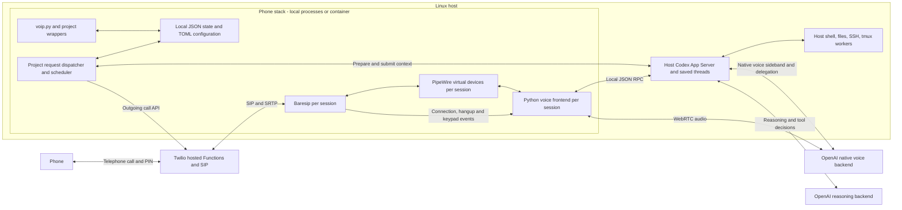

# Current voice operator architecture

Checked against the implementation on September 21, 2026. This describes what
runs today. The larger client/server refactor and its proposed API were abandoned;
changes will build on these existing components.

Use [interfaces and flows](docs/INTERFACES-AND-FLOWS.md) for commands and walkthroughs,
[configuration](docs/CONFIGURATION.md) for file formats, and [README](README.md)
for installation and service operation. Each project keeps its prompts, planning
files, state and logs in its own configured workspace.

## Components and connections

The SIP event monitor also handles keypad recovery independently of the frontend.
The frontend supplies microphone audio and plays returned speech; Codex retains
the conversation and uses its normal tools. Claude/Codex workers remain ordinary
CLI or tmux sessions. There is no separate reasoning agent that manages them.

The current application interface is the local CLI and configuration files.
There is no general HTTP API for mailboxes, requests or schedules, and no remote
client enrollment service. The web handlers are protected, Twilio-hosted call/PIN
handlers. Named operators use the configured host Codex daemon/account. In the
container deployment the frontend reaches that daemon over a mounted Unix
WebSocket directory; tools execute on the host. Workspaces have the same absolute
paths in both environments. This is a local deployment option, not the abandoned
multi-machine account-routing API. See [container boundaries](docs/CONTAINERS.md).

## Source map

| File | Implemented responsibility |
| --- | --- |
| [release_cli.py](release_cli.py), [release_config.py](release_config.py) | Installation, explicit permissions/credential loading, status/doctor, JSON command envelope and configuration previews |
| [service_runtime.py](service_runtime.py), [container](container/entrypoint.sh) | Foreground stack supervision, owned-process cleanup, container-local audio and startup |
| [voip.py](voip.py) | CLI, project/session resolution, virtual audio setup, native thread selection, tmux hosting and service generation |
| [voice_config.py](voice_config.py) | Session profiles, recipients, external project registration, prompts and retry policy |
| [service_config.py](service_config.py) | Validate configuration, deploy hosted routes/verifiers and install services |
| [directory_routes.py](directory_routes.py), [directory_service.py](directory_service.py) | Opt-in tmux directory discovery, compressed extension numbering, persistent directory operators and leased private Sync routes |
| [operator_mailbox.py](operator_mailbox.py) | Recipient/project messages, explicit address/reopen, atomic persistence |
| [requests_queue.py](requests_queue.py) | Durable requests, admission decisions, attempts/retries, cancellation, dispatcher loop |
| [request_runtime.py](request_runtime.py) | Current native/SIP/media readiness, context submission, configured resets and dialing adapter |
| [call_schedule.py](call_schedule.py) | Cron evaluation, occurrence recovery, agenda materialization and missed-call notices |
| [call_preparation.py](call_preparation.py) | Agenda snapshot, native preparation turn and prepared opening |
| [outgoing_calls.py](outgoing_calls.py) | Twilio call submission/status/cancellation, signed tickets and uncertain-attempt reconciliation |
| [call_events.py](call_events.py) | Baresip connection/end observations, recipient identities and native call notices |
| [keypad_control.py](keypad_control.py), [operator_reset.py](operator_reset.py) | Independent DTMF commands and frontend/same-thread/fresh-thread recovery |
| [voice_frontend.py](voice_frontend.py), [codex_rpc.py](codex_rpc.py) | PipeWire audio/WebRTC and local daemon WebSocket transport |
| [pin_security.py](pin_security.py), [pin_delivery.py](pin_delivery.py) | PIN verifiers, encrypted temporary delivery prompts and IVR retry/receipt handling |
| [twilio](twilio/README.md) | Protected incoming, authorization, outgoing and PIN-delivery handlers |
| [session_inspector.py](session_inspector.py) | Read-only view of native turns, tools and separately timed saved speech |

## Projects, sessions and callers

A project is a local workspace directory. A named session selects a profile in
that project and a saved native thread. Each session has separate audio device
names, Baresip identity/control port, frontend process and thread ID. `default`
uses the original names; named profiles add their session suffix.

The provider's `server.toml` registers external projects by directory. Each
external project has its own configuration and `session_ids`; several sessions
can belong to one project. Registration resolves locally, not over a remote
service protocol. Sessions across the provider/projects have unique names and
configured extensions.

Optional [directory extensions](docs/DIRECTORY-EXTENSIONS.md) add dedicated
operators for active tmux directories and a home default for selected recipients.
Their private metadata lives under provider state while native tools run in the
selected directory. Stable directory identities preserve conversations across
extension renumbering. Manual routes and existing project schedules retain their
configured targets.

Recipients have a configured phone number, separate PIN verifier, allowed session
list and `incoming_session`. For example, one caller can default to `default` and
another to a project session, while a registered extension selects an explicitly
allowed alternative. A separate generic operator for every caller is not created
automatically; routing is configuration.

Each recipient/project pair has a mailbox shared by that person's sessions in
the project. Its filename includes a hash of the configured phone number;
changing that number starts another mailbox and preserves the old file. These
are routing/data groupings, not OS isolation. Sessions retain host tools and a
shared conversation can remember earlier callers. Sender labels are descriptive,
not authenticated identities granting extra permissions.

## State and configuration

Let `P` be the selected project root. Project-wide state is `P/state`. Session
state is `P/state` for `default`, or `P/state/sessions/NAME` for a named profile.
Provider infrastructure remains in the provider's own `state` directory.

| Location | Contents |
| --- | --- |
| Provider `server.toml` | Shared audio/operator/SIP defaults, Twilio number, project registrations |
| Project recipient/session/schedule TOML files | Allowed callers/default routes, prompts/reset/retry policy, cron definitions; paths can be configured |
| Project `state/mailboxes/` | Recipient/phone-bound messages and outcome notes |
| Project `state/requests.json` | Request specifications, snapshots, queue state, retry/attempt references |
| Project `state/outgoing-calls.json` | Provider attempts and private call-admission data |
| Project `state/schedule-state.json` | Occurrence and skipped-call ledger |
| Project `state/pin-deliveries.json` | PIN delivery jobs; pending jobs can contain encrypted secret material |
| Session `operator-thread-id`, `voice.json`, `voice-activity.json` | Selected conversation, frontend/process state and audio observations |
| Session `call-preparations.json`, `call-events.json` | Prepared agendas and identified connection/end notices |
| Session reset/keypad state | Recovery transaction and keypad action receipts |
| Codex home | Native daemon databases, credentials and rollout logs; scoped exports may live in a project |

Writers use filesystem locks and atomic file replacement; mailbox/queue helpers
also sync directory metadata. There is no central SQL database or transaction
covering every file/provider operation. Stable keys and saved intermediate state
support retry/recovery. Do not edit locks, delete ledgers or invent new request
keys to get around uncertain submissions. Private state can contain agendas,
phone numbers, tickets or encrypted credentials; it is not a public event API.

The dispatcher checks schedules periodically and considers preemptive requests
first. Each external project has its own dispatcher/queue. Schedules reload from
their TOML file. Recipient/routes/profile changes use `config check` and
`config apply`; applying can deploy provider configuration and manage services.

## Persistent operator and call lifecycle

Ordinary calls and hangups keep the selected Codex conversation. The frontend
starts native realtime with its own WebRTC offer and native handoffs enabled.
The local RPC helper performs a WebSocket upgrade over the daemon's Unix socket.
tmux hosts the frontend process, not a standard interactive Codex terminal UI.

The request path distinguishes queueing, preparation, provider dialing, PIN/SIP
connection, native prompt acceptance and mailbox completion. Preparation is done
before an outgoing call rings. A matching connection carries the prepared opening
so the operator can discuss the agenda without first fetching it again.

A matching recipient already connected to that session receives the new topic
on the same call. Another recipient targeting that occupied session waits.
Different sessions can place concurrent calls, including to the same number.
Preemption submits context; it does not cancel tasks or merge calls. There is
one Baresip call per profile, not a shared conference.

The SIP monitor emits an identified hangup notice asking the operator to review
messages from that call. It does not itself resolve them or run an independent
guaranteed backend review job. Reading, speaking and hanging up do not establish
that a message's purpose was fulfilled. See the reliability limits below.

Keypad `*1#` reconnects voice, `*2#` reloads the same conversation, and `*3#` saves
the old conversation and selects a new one. The phone leg stays connected during
recovery. Full/fresh reset can interrupt the operator's work; ordinary tmux
workers continue. Profiles can also explicitly request a fresh conversation
before an outgoing attempt. Reusing an already-connected call does not reset it.

## Supervision and today's Example Project schedule

User services/timers supervise audio, the operator/frontend, Baresip, SIP events
and request dispatch. Named sessions use `@NAME` instances. A registered external
project uses one request service named for its first configured session, shared
by the sessions in that project. The supervisor is infrastructure, not a worker
agent interface.

On September 21, `/path/to/project/voice/schedules.toml` still enables
`project-daily-standup` at **09:00 America/Chicago every day**. It targets the project user's
`project` session, retries busy/no-answer after 300 and 600 seconds, allows three
attempts total, and has a one-hour request lifetime. `voip-requests@project.service`
was enabled and active; the Example Project frontend reported voice connected. These are
observations at inspection time, not a guarantee of a future completed call.

The scheduler's offline default is skip, with a nonzero skipped count attached
to the next applicable connection notice. A network-only outage while the
scheduler is running can instead leave an already-created request waiting to
expiry. Busy calls follow ordinary request admission. See
[requests and schedules](docs/REQUESTS-AND-SCHEDULES.md) for exact recovery rules.

## Evidence, limitations and incremental work

[Handset acceptance](docs/MANUAL-ACCEPTANCE-2026-09-19.md) covers prepared outgoing
calls, same-call topics, different-number and same-number concurrency, PIN routing,
keypad recovery and a completed retry. [Automated acceptance](docs/VOICE-ACCEPTANCE-RESULTS.md)
retains both passes and failures from native TTS/STT tests.

Known limitations include unreliable automatic hangup review, inconsistent spoken
opening/topic delivery in some tests, and failed spoken-only recall checks after
same-thread recovery. Preserving a UUID is not proof of recall. A connected audio
transport is not proof that native tools are responsive. Actual handset pause
timing for saved extension/PIN contacts still needs its own check.

Keep measured tool execution/recording time, native backend turn time, result
handoff and saved speech timestamps separate. A transcript-save time does not
establish when someone heard the answer. The [latency report](docs/VOICE-LATENCY-REPORT.md)
and [session inspector](docs/SESSION-INSPECTOR.md) retain that distinction.

Shared calls with several participants and speaker identification remain a
requested future feature. They are not implemented, and are not contingent on
resurrecting the abandoned refactor. Any later change needs participant lifecycle
and audience handling as well as frontend speaker information; a voice label
alone is not authentication.
