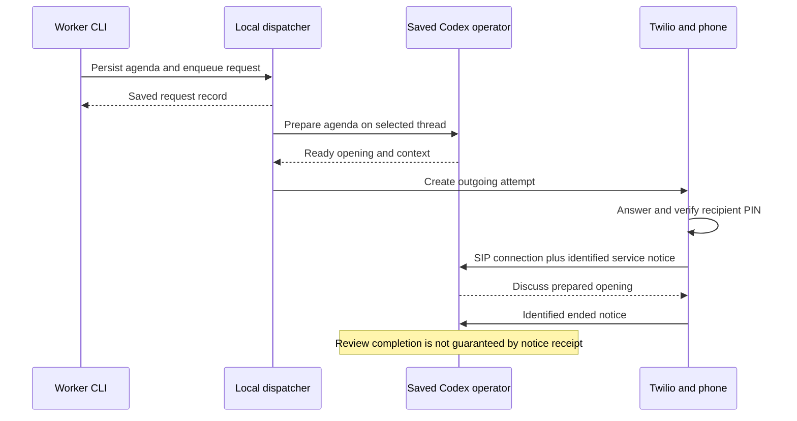

# Implemented interfaces and call flows

Checked against the CLI and source on September 21, 2026. This is a reference for
the current service, not a proposed API. See [architecture](../ARCHITECTURE.md)
for component/state ownership and the linked guides for detailed configuration.

## Entry points and scope

Run the provider CLI from `/path/to/voip`:

```bash
python3 voip.py --help
python3 voip.py --session default operator status
python3 voip.py --session project operator status
```

The selected session resolves its project directory, prompts, recipient defaults,
mailbox and saved thread. `--root /path/to/project --session NAME` selects a
project explicitly. For Example Project, `/path/to/project/bin/voice` is the existing wrapper;
it selects that project's `project` session from any working directory.

Workers should name the recipient explicitly. Mailbox commands without a recipient
use the identified live caller when available, otherwise the project's configured
default/sole eligible recipient. A stale or unidentified active call can make that
inference fail; do not substitute someone else's mailbox. `--to` selects a
configured phone number instead of a recipient name, not an arbitrary destination.

These commands run with the local OS user's access. There are no application
bearer tokens or HTTP authorization scopes. `--from` is a self-reported label.
Mailbox/session separation does not isolate host tools or conversation history.

## CLI interface

| Commands | Behavior and output |
| --- | --- |
| `mailbox post --from LABEL --subject TEXT --key KEY --file FILE` | Persist message; print its ID. `--body` or `--file -` are alternatives. Default notification is nonpreemptive. |
| `mailbox list [--all]`, `count`, `read ID` | Tab-separated summaries, integer count, or foraliceed message text. Reading does not resolve. |
| `mailbox address ID --note TEXT`, `reopen ID` | Change resolution state; print ID/status. A concrete note is operator protocol, although the CLI argument defaults to empty. |
| `mailbox migrate --recipient NAME` | Explicitly assign the selected session's legacy mailbox to a recipient; print a JSON result. |
| `request message` / `request call` | Enqueue context or a phone request; print a JSON record. `--file` can first post the agenda under the same stable key. |
| `call start` | Alias for enqueueing a call request. It returns without waiting for ringing or connection. |
| `call prepare` | Prepare the operator without dialing; print JSON. `--brief-file` supports an operator that already prepared its own agenda. |
| `request status [KEY]`, `cancel KEY`, `resume KEY` | Read queue state, withdraw work, or resume an inspected blocked submission; JSON output. |
| `call status [KEY] [--local]`, `cancel KEY`, `reconcile KEY` | A known queue key uses the queue for status/cancel; otherwise operates on provider-attempt records. Reconciliation requires the original attempt identity. |
| `schedule list`, `next --count N`, `tick --dry-run` | Inspect loaded cron definitions/upcoming times/due work as JSON. Plain `tick` can enqueue real calls. |
| `config check`, `config apply` | Validate configuration, or deploy hosted access settings and install/manage services. JSON result. |
| `operator status`, `ensure`, `pause`, `unpause` | Inspect/reconcile/suspend/resume frontend supervision. `pause` is not worker-task cancellation. |
| `operator reset --scope frontend\|session\|fresh` | Recover voice, reload the same thread, or select a fresh saved conversation. |
| `pin generate`, `status`, `cancel`, `reconcile` | Restricted PIN lifecycle described below; status returns metadata, not plaintext PINs. |

`--help` on each subcommand gives its implemented arguments. The release CLI adds `--json` with a versioned envelope; machine mailbox commands
require an explicit recipient. There is no REST endpoint. Python modules
expose implementation classes such as `Mailbox`, `Requests`, `Scheduler`,
`Preparations` and `Calls`; these are internal interfaces rather than a versioned
network SDK. Prefer the CLI for other agents and inspect code before depending
on a private class or saved-record shape.

## Incoming call: generic operator or Example Project extension

1. Twilio invokes protected [`/incoming`](../twilio/incoming.js). The handler
   checks the configured server number and recognized caller and collects DTMF.
2. With ordinary PIN entry, [`/authorize`](../twilio/authorize.js) verifies the
   caller's own PIN and selects their `incoming_session`. There is no project
   selection menu after authentication. the primary user currently reaches `default`;
   the project user currently reaches `project`.
3. A short configured `extension#` before the PIN selects an allowed session and
   opens the PIN collector for that route. Extensions are 1–5 digits, starting
   with 1–9; personal PINs are 6–12 digits. The extension grants no extra access.
   Wrong PINs or unauthorized routes end the call without connecting the operator.
4. The handler dials the session's registered Baresip SIP endpoint with secure
   media. The local SIP identity includes the recipient. The monitor records the
   connected call, and the frontend supplies the corresponding native notice.
5. The profile's connection prompt guides the operator. The notice mentions
   mailbox count only when nonzero. Those notices are context, not words to read
   aloud. The operator checks that caller's project mailbox through the CLI.

Extension `200#` selects Example Project; `100#` selects the primary user's default operator for allowed
callers. A saved contact can include pauses and extension/PIN digits as described
in [configuration](CONFIGURATION.md#incoming-project-extensions). Call-history
preservation and actual handset pause timing are not assumed. There is no current
transfer mechanism for changing the session of an already-connected call.

## Worker message and prepared outgoing call

These are examples of commands that write real state and can dial when executed;
they were not executed to produce this documentation. Use one stable key for the
intended operation, and keep Example Project agenda files in `/path/to/project`.

```bash
python3 voip.py --session project mailbox --recipient bob post \
  --from claude:project-review --subject 'Example Project review agenda' \
  --key project-review-example --file /path/to/project/prompts/daily-agenda.md \
  --notify passive

python3 voip.py --session project call start --recipient bob \
  --request-key project-review-call-example --reason 'Discuss the Example Project review agenda' \
  --message project-review-example

python3 voip.py --session project request status project-review-call-example
```

Passive posting stores the agenda without creating a separate notification.
Alternatively, `request call --file FILE --from LABEL --request-key KEY ...`
posts a message and enqueues the call in one CLI invocation. These are separate
durable file writes, not one transaction; retrying with the same key recovers a
partial operation without duplicating the message.



The dispatcher checks readiness and handles configured reset-on-outgoing once
per attempt, then the selected operator prepares the actual agenda. Preparation
binds the recipient/number, messages and saved thread. A ready brief precedes
dialing. Workers must not supply briefs as if they were the operator. The operator
can use `call prepare --brief-file FILE` after reading its agenda to avoid asking
its own busy turn to prepare again; see [outgoing calls](OUTGOING-CALLS.md).

The hosted [`/outgoing`](../twilio/outgoing.js) validates a signed attempt ticket,
the provider/call/destination and the recipient's PIN, then bridges that profile's
SIP endpoint. The local connection identity selects the matching prepared opening.
The operator is instructed to discuss it immediately, without first fetching the
mailbox again. This is the implemented protocol, not a guarantee that every native
voice response follows the prompt promptly.

## Messages and scheduled topics during an active call

`mailbox post --notify non_preemptive` (the default) creates a context request.
`--notify preemptive` makes it eligible for immediate submission; passive creates
no request. `request message` provides the same explicit queue interface.

| Observed state | Dispatcher behavior |
| --- | --- |
| Same recipient connected to the requested session | Deliver the topic on that call; no extra ring or reset |
| Another recipient connected to that session | Wait, even for a preemptive request |
| Recipient connected on another session | Allow a separate call from the requested session |
| Nonpreemptive context/reused-call request | Wait for native backend idle and a fresh local audio-pause observation |
| Preemptive context | Submit via realtime text on a connected call, steer a busy off-call turn, or start an idle native turn |
| New phone attempt | Wait for an available session/backend and completed preparation |

Readiness currently requires a connected frontend, live process and fresh SIP
observer. The audio-pause heuristic requires recent activity observations and
approximately two seconds without detected input/output signal. It is not proof
of conversational turn completion. Native submission returns a receipt, not
proof the topic was spoken or handled. Preemption does not kill existing work.

## Daily Example Project standup

The actual definition is `/path/to/project/voice/schedules.toml`:

```toml
[[schedules]]
id = "project-daily-standup"
enabled = true
cron = "0 9 * * *"
timezone = "America/Chicago"
session = "project"
recipient = "bob"
reason = "Daily Example Project standup: yesterday, schedule adjustments, then today's detailed plan"
agenda_file = "../prompts/daily-agenda.md"
mode = "non_preemptive"
misfire = "skip"
ttl_seconds = 3600

[schedules.redial]
delays_seconds = [300, 600]
max_attempts = 3
retry_on = ["busy", "no-answer"]
```

The project's request dispatcher checks cron, saves a unique occurrence key,
materializes a recipient mailbox agenda and enqueues an ordinary call request.
An interrupted agenda/queue write resumes from saved occurrence state. The call
then follows the preparation/PIN/opening path above. If the project user is already on
Example Project, the scheduled topic reuses that call; an occupied session with another
recipient waits under normal admission.

The project prompts cover yesterday's actual work, adjustments to an off-track
schedule, and today's detailed plan. Notes and planning files stay under
`/path/to/project`; app access uses the existing SSH setup to the project user's laptop.
The phone service itself does not implement an iOS development process.

```bash
/path/to/project/bin/voice schedule next --count 3
/path/to/project/bin/voice request status
systemctl --user is-active voip-requests@project.service
```

To disable future calls, edit `enabled = false` in that project schedule file;
the dispatcher reloads it. Cancel an already-created request separately. There
is no HTTP schedule resource or one-time calendar API. For an immediate manual
meeting, use a normal call request without changing cron.

With `misfire = "skip"`, missed scheduler occurrences are skipped and counted
for the next connection to the matching session/recipient. A running scheduler
with unavailable voice/network can instead create a request that waits to its
TTL. Do not interpret those different conditions as the same missed-call count.
Cron timezone, DST and optional bounded catch-up behavior are documented in
[requests and schedules](REQUESTS-AND-SCHEDULES.md).

## Hangup, completion and pending decisions

Baresip's end event is recorded with the call identity, recipient and observation
time. The frontend submits a notice telling the operator that this specific call
ended, and instructing it to review the messages discussed on that call. There
is currently no separate durable backend review job guaranteeing it happens.
Automated and handset tests found notices accepted without the review running.

The operator should inspect current mailbox state and project evidence, then:

```bash
python3 voip.py --session project mailbox --recipient bob list
python3 voip.py --session project mailbox --recipient bob read MESSAGE_ID
python3 voip.py --session project mailbox --recipient bob address MESSAGE_ID \
  --note 'Agreed outcome and where it was recorded'
```

Resolve only when the purpose is fulfilled. A deferred decision or promised
follow-up stays unaddressed. A notification can be complete once delivered and
acknowledged. Reading, preparation, speech or hangup alone is insufficient.
Repeated notices refer to the same call; preserve already-addressed outcomes.
`reopen ID` explicitly makes the message unaddressed and clears its resolution.
An ordinary hangup does not authorize another call or cancel workers.

## Retries, uncertainty and cancellation

`--retry-delays 1m,5m,8m,60m` means intervals after successive failed attempts.
The explicit list defaults to one initial attempt plus its entries; a larger
configured cap repeats the final interval. Fixed/backoff settings also exist.
Busy/no-answer are normal eligible outcomes; pre-PIN hangup retries require the
explicit `ended_without_sip_connection` policy. Connected-call hangup never retries.
TTL still limits pending attempts; it does not cut off an active call.

```bash
python3 voip.py --session project request cancel REQUEST_KEY
python3 voip.py --session project request status REQUEST_KEY
```

Cancellation withdraws dispatch and asks the dispatcher to end an owned phone
attempt. Check `cancel_settled` before reporting cleanup complete. A topic that
was submitted on an existing call did not create its own phone attempt; cancelling
the request does not retract its accepted native input. Cancellation does not
stop the native task or ordinary worker processes.

An unknown provider/prompt outcome blocks further submission. Inspect
`call status ATTEMPT_KEY --local` and the relevant native/provider records, then
use `call reconcile ATTEMPT_KEY` for the exact attempt. `request resume KEY
--confirm-no-prompt` is an assertion that inspection established no prompt was
accepted, not a generic retry switch. Preserve the original key; do not bypass
an uncertain dial by requesting another one.

## Record meanings for callers reading JSON status

`request status` returns the actual saved record. Fields currently include
`key`, `spec`, `state`, `created_at`, `updated_at`, `expires_at`, `prompt_state`,
`attempts` and `next_attempt_at`; additional progress can include `waiting_for`,
`prompt_result`, `last_attempt`, `outcome` and `cancel_settled`. Timestamps are Unix
seconds. `spec` includes selected session/recipient/number, kind, reason, mode,
message IDs, TTL and a retry-policy snapshot. Messages omitted at initial enqueue
select the then-unaddressed mailbox messages; retrying that key keeps the selection.

| Queue state | What it establishes |
| --- | --- |
| `queued` | Saved and awaiting admission |
| `dispatching` | Working on the attempt, which can include reset/preparation/provider submission |
| `active` | Attempt still active; inspect `last_attempt`/call status for provider and SIP detail |
| `retry_wait` | A known eligible failure has a saved next-attempt time |
| `prompt_submitted` | Terminal queue result for accepted context/reuse; not proof of speech or work completion |
| `blocked` | Ambiguous submission requires inspection/reconciliation |
| `completed` | Call/request lifecycle finished or selected agenda already resolved; not blanket mailbox completion |
| `cancelled` | Dispatch withdrawn; provider cleanup can still be pending |
| `expired`, `failed` | Request lifetime ended or attempts/operation failed |

Preparation and phone-attempt records hold their own progress details separately
from queue state. There is no event-subscription API or claimed exactly-once native execution.
Identical stable keys deduplicate their local operation; conflicting contents
are rejected. Reading JSON state is useful for inspection, but editing it bypasses
locks and recovery logic.

## Keypad recovery and PIN delivery

| Keypad | Equivalent CLI |
| --- | --- |
| `*1#` | `operator reset --scope frontend` |
| `*2#` | `operator reset --scope session` |
| `*3#` | `operator reset --scope fresh` |

The independent SIP monitor handles these commands after call authentication,
keeps the phone leg, and gives local recovery feedback. Additional resets are
ignored while one is running and during its cooldown. The result establishes
recovery state, not guaranteed recall or tool responsiveness. See
[keypad resets](KEYPAD-RESETS.md).

`pin generate RECIPIENT --delivery print` rotates a PIN and prints it once in the
user's private terminal; `config apply` subsequently activates the verifier on
the phone service. Never run that print command through an agent transcript.
`--delivery call --request-key KEY` instead saves encrypted pending delivery and
waits for matching deployment before dialing the dedicated hosted IVR.

The IVR offers `9#` to stop retries, reads the PIN, and requires entry of the
entire PIN to confirm. Its final retry delay repeats indefinitely until confirmed
or cancelled. Hosted opt-out works even while this machine is offline; encrypted
prompts are removed as the terminal receipt is processed. Status distinguishes
terminal outcome from settled phone cleanup. This IVR uses no Codex session and
waits for an existing provider call to that number to finish. Full commands and
secret-handling details are in [PIN delivery](PIN-DELIVERY.md).

## Observation and known gaps

Use `operator status`, `request status`, `call status`, project meeting notes,
the relevant native session logs and [session inspector](SESSION-INSPECTOR.md).
Mailbox lists cover the selected person/project; root request status does not
aggregate every external project's queue. Service health and model responsiveness
are different observations.

The test evidence retains failed automatic hangup review, some opening/topic
delivery failures, and spoken-only recall failures after reset. See
[handset results](MANUAL-ACCEPTANCE-2026-09-19.md) and
[automated acceptance](VOICE-ACCEPTANCE-RESULTS.md). Keep tool execution, native
backend time, result handoff, PCM observations and saved speech timestamps
separate. A transcript-save timestamp is not a measure of audible latency.
