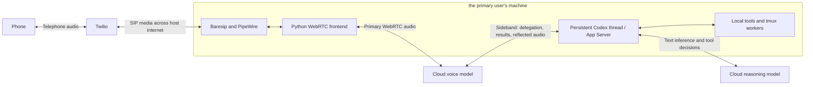
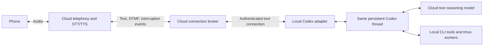

# Voice operator: tool latency, task control, and architecture alternatives

Prepared September 15, 2026, America/Los_Angeles. Research and local inspection
only; no service settings, model settings, calls, or sessions changed.
Updated September 16 to emphasize the primary user's phone clarification: the reported
problem is tool-call responsiveness and control through voice, while spoken
acknowledgments are prompt. A read-only local
[session inspector](SESSION-INSPECTOR.md) is available.

## Assessment

**The primary issue is slow or unreliable tool-call interactions through voice:
delegating work, obtaining useful results, querying status, and cancelling tasks.**
the primary user reports prompt spoken acknowledgments. A fresh session still took one or two
minutes to return a simple tmux query on the slower connection, versus a few
seconds on the faster one. The investigation should follow the work request from
delegation through tool execution and result delivery. Audio transport is a
possible contributor to that path, not the established diagnosis.

In the matching fresh-session history, the tmux call/result records are
**1.943 seconds apart**, and the backend turn's start/completion records are
**19.257 seconds apart**. The answer transcript is saved **155.017 seconds after
the backend completion record**. These are distinct measurements: the first
includes tool-wrapper/recording overhead, the second covers the recorded backend
turn, and the third is only a gap between saved records. Actual subprocess runtime,
result-handoff delay, and audible latency were not separately measured. The later
transcript timestamp does not prove that result delivery or playback waited that
long. See the detailed timeline and evidence limits in section 2E.

We also observed **about 1 Mbit/s of reflected audio messages arriving over the
native voice sideband**, in addition to the primary WebRTC audio. That remains a
possible source of control-channel congestion, not an established root cause.
A prompt acknowledgment weakens an explanation based on uniformly delayed input
or playback; it does not establish timely handoff/result delivery on a separate
connection. The operator's `xhigh` reasoning may contribute to its baseline delay,
but neither that setting nor session age alone explains the reported large
connection-dependent difference. Bandwidth evidence (private historical evidence, excluded from this source distribution).

**Unverified cancellation is a separate correctness failure.** Moving audio to
the cloud would not, by itself, fix incomplete task inventories, premature claims
of cancellation, or stale results being presented as current progress.

The first recommendation is to instrument **delegation, tool dispatch/execution,
backend completion, and result handoff separately**, then compare equivalent text
and voice requests against the same Codex backend configuration. Status and
cancellation need verified runtime outcomes regardless of network speed.

If those measurements identify host-network congestion or the extra voice-model
handoff as a significant contributor, a candidate to evaluate is
**cloud speech handling connected by text to the existing persistent local Codex
operator**. Twilio ConversationRelay is a particularly relevant implementation
candidate. It would preserve Codex's machine access while removing telephone and
voice-model audio from the host's internet connection. Moving audio alone is not
a demonstrated fix for tool latency or task control.

## 1. What this installation actually does

This review checked installed Codex **0.154.0**, our
[audio frontend](../voice_frontend.py), matching Codex source, the saved operator's
turn metadata, and retained native logs. It does not assume that ChatGPT's app,
every Codex client, or the public Realtime API uses exactly this implementation.



The Python frontend uses `clientManagedHandoffs=false`: Codex itself handles
delegation. In the matching source, V3 voice defaults to `gpt-live-1-codex`.
When the voice model requests work, Codex converts the handoff into input for its
ordinary agent. Local tools run through that agent, and results return to the
voice model for speech. One persistent operator conversation therefore involves
**two model roles**. [Codex's realtime implementation](https://github.com/openai/codex/blob/rust-v0.154.0/codex-rs/core/src/realtime_conversation.rs).

This resembles the public GPT-Live architecture: a conversational speech model
delegates reasoning and tools to a backend. OpenAI separately documents the
Realtime API's integrated speech/tool model and the conventional
speech-to-text → text agent → text-to-speech pipeline. These are different
architectural choices. The current public Live protocol is not necessarily a
drop-in replacement for Codex's account-backed experimental protocol.
[OpenAI voice architecture guide](https://developers.openai.com/api/docs/guides/voice-agents).

For a spoken tool request, the meaningful path is approximately:

1. Phone audio reaches Twilio, then the host, then the cloud voice model.
2. The voice model recognizes the request and delegates over the sideband.
3. Local Codex obtains reasoning/tool decisions from its cloud text model.
4. The host executes tools; further model/tool rounds may follow.
5. Useful results return to the voice model and become audio.
6. That audio returns through the host and Twilio to the phone.

Ordinary text input skips the speech/delegation layer. Also, telephone audio makes
a cloud → home → cloud detour in both conversational directions. Staying connected
avoids setup costs; it does not eliminate these dependencies.

The native implementation already supports streaming handoff output, with a
200 ms flush interval. It is not architecturally required to wait for an entire
tool task before returning progress. Whether useful progress is produced and
spoken promptly still needs measurement. A spoken acknowledgment such as
“checking” does not establish that a tool has started or finished.

## 2. The most actionable local findings

For the reported tool-call problem, start with **2E (the tmux execution timeline)**
and **2F (status/cancellation correctness)**. Sections 2A–2D describe possible
contributors and measurement limits; their order does not rank likely causes.

### A. Audio is also arriving on the control connection

Native wire logs contain both `session.input_audio.append` and
`session.output_audio.delta` messages on the sideband. In the saved ten-second
sample, each carried a 12,800-character base64 audio string, decoding to 9,600
bytes. Output timestamps span 200 ms per chunk. The public documentation explicitly
describes reflected input as 24 kHz mono PCM16LE and also documents reflected output
on sideband connections. [Input reflection reference](https://developers.openai.com/api/reference/resources/live/sideband-websocket),
[output reflection reference](https://developers.openai.com/api/reference/typescript/resources/live).

Observed interval: **2026-09-16 01:29:48–01:29:58 UTC**, or September 15,
18:29:48–18:29:58 PDT:

| Received event | Count | JSON payload bytes |
| --- | ---: | ---: |
| Reflected input audio | 50 | 642,400 |
| Reflected output audio | 50 | 644,200 |
| Total | 100 | 1,286,600 |

That is **1.029 Mbit/s of application payload**. The expected audio-only budget
for two such streams is similarly:

```text
24,000 samples/s × 2 bytes/sample × 4/3 base64 expansion × 2 streams
= 128,000 bytes/s
= 1.024 Mbit/s
```

Both reflected streams arrive **downstream to the host**; this is not one stream
in each network direction. The count uses only the TRACE wire-log records and
excludes duplicate DEBUG logging. The sanitized
evidence file (private historical evidence, excluded from this source distribution) records the selection method,
counts, sizes, and limitations. Rotating logs do not support deriving a session-wide
average by dividing all retained bytes by the oldest and newest timestamps.

The matching parser does not recognize these `session.*` audio event names:
it logs and ignores them after receipt. They therefore consume bandwidth and
processing even though our frontend plays the separate WebRTC audio.
[Codex V3 parser](https://github.com/openai/codex/blob/rust-v0.154.0/codex-rs/codex-api/src/endpoint/realtime_websocket/protocol_frameless_bidi.rs).

**Inference:** when available bandwidth approaches this continuous load,
control messages can arrive late. The sideband is an ordered WebSocket over TCP;
lost or delayed bytes can hold up subsequent bytes, including small delegation
messages. Congestion can also affect the separate text inference connection.
This gives a concrete mechanism for a much larger voice/text gap on a poor link.
[TCP head-of-line blocking background, RFC 8087](https://www.rfc-editor.org/rfc/rfc8087.html).

Limits: we did not measure actual wire compression, packet overhead, TCP
retransmissions, queue age, or link capacity. Consequently, “1 Mbit/s” is not a
proven minimum connection speed or a diagnosis of either router. Nor does one
sample establish whether reflection continues at that rate in every idle state.

Discarding audio **after downloading it** cannot recover WAN bandwidth. A fix
would need server-side suppression, a cloud sideband consumer that forwards only
relevant text/control, or a different transport architecture. I found no verified
Codex configuration switch for disabling reflection. The documented WebRTC
frontend event allowlist explicitly does not restrict trusted sideband connections.
[Live transport configuration](https://developers.openai.com/api/reference/typescript/resources/live).

### B. The reasoning backend is configured for substantial reasoning

The saved operator's recent `turn_context` entries—not just the global
configuration—show `gpt-6-astra` with `xhigh` effort. That is a plausible contributor
to delay before tool selection and between tool steps.

It cannot by itself explain a voice/text difference if the text comparison uses
the same model, effort, and context. The appropriate experiment is an
**operator-specific** effort comparison on routine status/dispatch requests,
keeping task quality visible. It does not require changing worker configurations
or the machine's global default. OpenAI's delegation guidance treats backend model
and reasoning effort as independent latency choices.
[Delegation latency guidance](https://developers.openai.com/api/docs/guides/live-delegation).

### C. Small audio buffers do not explain the whole delay

Our microphone queue holds at most four 20 ms frames, or 80 ms, and drops old input
on stalls. PulseAudio compatibility commands request 20 ms latency. These are
local bounds/requests, not measured end-to-end latency guarantees; codec, socket,
server, playback, and jitter buffers still matter. The installed aiortc encoder
defaults to 96 kbit/s Opus and a stereo encoding layout despite the mono source.
That is an encoder setting, not a measured negotiated wire rate.

The native WebSocket implementation has an unbounded internal receive queue and
performs awaited writes in its socket pump. These are places to measure backlog;
source inspection does not prove they accumulated one during your call.
[Native WebSocket implementation](https://github.com/openai/codex/blob/rust-v0.154.0/codex-rs/codex-api/src/endpoint/realtime_websocket/methods.rs).

### D. Our existing timestamps cannot settle the question

The frontend currently does not retain live transcript timing notifications for
latency analysis. Its connection flag confirms startup, not continuing progress
through every model/control path. Saved conversation transcripts can be finalized
later: one inspected assistant transcript was persisted at exactly the
realtime-session-close timestamp. Subtracting that from tool completion would
mislabel persistence delay as speech latency.

We need live event timestamps and actual audio playback measurements. Missing or
late saved transcript text alone does not prove that the voice model failed to
hear speech. Existing raw debug logging also repeats full audio payloads;
future performance instrumentation should record event metadata and lengths.

### E. Follow-up: the fresh tmux query did not spend minutes executing tools

the primary user reports immediate spoken acknowledgment, a one- to two-minute wait for a
simple tmux query on the slower connection, a few seconds on the faster one,
and no improvement after resetting to a fresh conversation. These are user
observations, not controlled benchmark timings.

The current saved operator contains a matching initial tmux listing. The request
ran `tmux list-sessions` and `tmux list-panes` through one tool wrapper. Its records
show the following on September 15 (UTC):

| Saved event | Time | Interval from backend turn start |
| --- | --- | ---: |
| Backend turn started | 21:35:00.398 | 0.000 s |
| Voice acknowledgment transcript saved | 21:35:08.049 | 7.651 s |
| tmux tool wrapper call recorded | 21:35:11.027 | 10.629 s |
| Tool results recorded | 21:35:12.970 | 12.572 s |
| Backend turn complete | 21:35:19.655 | 19.257 s |
| Another “checking” voice transcript saved | 21:37:24.319 | 143.921 s |
| Voice transcript listing the sessions saved | 21:37:54.672 | 174.274 s |

The tool call/result interval is **1.943 seconds**, including the wrapper and
recording overhead; this is not a direct subprocess wall-time measurement.
The backend completion record precedes the later saved voice texts. Because saved
speech can lag actual playback, these records do not locate the user-experienced
delay between delegation, backend processing, result transmission, voice-model
processing, and audio delivery. They neither establish minutes of command
execution nor prove minutes of waiting after backend completion.

| Quantity | Evidence available | What remains unknown |
| --- | --- | --- |
| Actual tmux subprocess runtime | Not separately measured in this analysis | Command start/exit timing within the wrapper |
| Tool call/result record interval | 1.943 s | Breakdown between dispatch, execution, wrapper, and recording overhead |
| Backend turn record interval | 19.257 s | Breakdown between scheduling, inference, tool work, and finalization; it is not an additional interval to add to the tool interval |
| Result handoff to the voice model | No correlated send/receipt/acceptance timing established | Queueing, transport delay, and when the voice model could use the result; streaming can begin before the backend turn ends |
| Backend completion record → saved answer transcript | 155.017 s | Relationship to result handoff, speech generation, and playback; it is not an audible-latency measurement |

This one recorded query helps narrow the investigation but does not establish
the cause of every slow tool request the primary user experienced.

```mermaid
sequenceDiagram
    participant V as Voice model
    participant C as Local Codex backend
    participant T as tmux tools
    Note over V,C: Voice can acknowledge independently of useful results
    C->>T: Tool call recorded (+10.629 s)
    T-->>C: Results recorded (+12.572 s)
    Note over C: Backend turn completes (+19.257 s)
    Note over V,C: Result transmission, model use, and handset playback times unmeasured
    Note over V: Answer transcript saved (+174.274 s); not a playback timestamp
```

The history also contains repeated copies of a later worker-status answer around
voice reconnections without additional tool-call records. This is evidence of
repeated saved answer text, not proof the worker ran again or that each copy was
heard. A task-completion announcement therefore cannot stand in for task-state
verification.

### F. Cancellation and status need authoritative state

The native voice handoff delivers text to the ordinary Codex agent. Our current
audio frontend does not add a task inventory or a separate status/cancel API.
Voice requests to inspect or cancel work depend on delegation and the agent's
actual actions. Keypad resets do use a separate `turn/interrupt` path and check
operator state, but intentionally leave ordinary tmux workers alone.
[Frontend](../voice_frontend.py), [reset implementation](../operator_reset.py).

OpenAI's official guidance explicitly distinguishes speech interruption from
backend cancellation, requires verification before claiming cancellation, and
calls for ignoring late results from superseded work. Those are application
responsibilities; a fluent voice acknowledgment does not satisfy them.
[GPT-Live task-state guidance](https://developers.openai.com/api/docs/guides/live-delegation).

the primary user's cancellation example could involve a request never acted upon, only some
jobs stopped, an external worker continuing, or a previously produced result
announced late. The present evidence does not select one explanation. In every
case, “all cancelled” without verified scope and outcome was an incorrect report.

The design should distinguish at least the current Codex turn, its background
commands/delegations, and independent tmux workers. Status should come from actual
runtime/worker inspection. Cancellation should identify the intended jobs, issue
the appropriate interrupts or stop actions, verify their outcomes, and report
partial or unknown outcomes honestly. Late output from cancelled or superseded
work must not become a new success announcement. A compact operation record can
support this without replacing ordinary CLI tools with a worker-management service.

## 3. Relevant public reports

There are comparable reports, but no reviewed report establishes the cause of
this installation's slowdown:

| Original report | What it establishes | Limits |
| --- | --- | --- |
| [Codex #45018, September 12, 2026](https://github.com/openai/codex/issues/45018) | A macOS desktop user experienced much longer response-start delays late in an approximately 90-minute voice conversation. | Subjective timing; explicitly not a measured one- or two-minute threshold. Different client. |
| [Codex #35508, July 26, 2026](https://github.com/openai/codex/issues/35508) | A user reported progressive GPT-Live transcription slowdown after roughly three minutes and improvement with a new session. | A symptom report, not proof of a particular network or context bug. |

These justify testing session age independently of network quality. the primary user's fresh
session still exhibiting the delay is evidence against accumulated conversation
history being the sole explanation. The reports do not establish that periodic
fresh conversations are the right fix. Our keypad resets
are useful recovery tools; resetting history trades away continuity and does not
remove the audio bandwidth or model handoff costs.

## 4. Competing architectures

The key choices are **which component makes tool decisions**, **where speech is
processed**, and **what crosses the weak network link**. Changing the vendor
without changing those choices may retain the same bottleneck.

| Architecture / examples | How work reaches tools | Fit for this project and latency tradeoff |
| --- | --- | --- |
| Existing Codex / GPT-Live delegation | Speech model delegates to the normal Codex agent. | Preserves the current session and natural conversation during work. Adds delegation stages and currently carries reflected audio. Instrument tool dispatch and result handoff first; test reflection as a possible contributor. |
| Streaming STT → Codex → streaming TTS | Recognized text enters the same ordinary Codex thread; its response text becomes speech. | Removes the extra conversational model. Preserves Codex tools/history. Endpointing, speech interruptions, and output selection become our responsibility. Local STT/TTS avoids additional cloud speech trips but needs a hardware/quality benchmark. |
| Twilio ConversationRelay | Twilio handles speech; our service receives recognized text and returns text for speech. | Strong fit for weak host internet: keep speech in the cloud and send text to local Codex. Requires a persistent WebSocket adapter/broker and separate service costs. |
| Native speech-to-speech tool model: OpenAI Realtime or Gemini Live | The audio model itself calls application functions. | Can avoid a separate reasoning model for simple tools. Recreating Codex's full coding harness is substantial work. Exposing “ask Codex” as a function preserves Codex but restores the two-model dependency. |
| LiveKit Agents | Framework supports STT/LLM/TTS, realtime speech models, and mixed pipelines. | Useful transport, turn handling, and measurement infrastructure. It is not itself a faster reasoning model. Run the speech portion in the cloud to remove host audio traffic. |
| Pipecat | Composable speech/agent pipeline with voice activity and turn detection. | Useful for a custom Codex text adapter and explicit interruption behavior. Component choice and placement determine bandwidth and latency. |
| Managed platforms: Vapi, ElevenLabs Agents | Hosted speech orchestration connects to models/tools or a custom backend. | Reduces voice infrastructure work. Still needs a bridge to the persistent local Codex thread. Evaluate useful tool response time, not just advertised speech-start latency. |
| Local full-duplex speech research: Moshi | A local speech model can jointly process and generate speech. | Shows that natural dialogue need not require repeated cloud speech stages. Not evidence of Codex-equivalent coding/tool capability or acceptable speed on this host. |

The framework comparisons above are based on
[LiveKit's pipeline documentation](https://docs.livekit.io/agents/models/pipelines/)
and [Pipecat's speech-input design](https://docs.pipecat.ai/pipecat/learn/speech-input).
LiveKit also describes preemptive generation and turn/endpoint tuning, which can
reduce waiting when predictions are correct. Starting speech early does not
justify executing an uncertain or duplicated tool command.
[LiveKit turn tuning](https://docs.livekit.io/agents/logic/turns/tuning/).

OpenAI Realtime directly combines speech and tools, and its telephony guide
documents SIP integration. Putting media and its control observer in the cloud
would remove the home audio detour; merely moving SIP while leaving an
audio-reflecting sideband on the host may not.
[Realtime overview](https://developers.openai.com/api/docs/guides/realtime),
[telephony/SIP guide](https://developers.openai.com/api/docs/guides/voice-sip).

Gemini's tool behavior needs version-specific checking: calls are sequential by
default. Nonblocking function execution is documented for supported models, but
the current guide explicitly says Gemini 3.1 Flash Live does not yet support
asynchronous function calling. A “live” product name does not guarantee that
conversation stays responsive during a long tool call.
[Gemini Live tools](https://ai.google.dev/gemini-api/docs/live-api/tools).

ElevenLabs discusses endpointing, model first-token time, and overlapping text
generation with speech synthesis. Those are relevant optimizations for the
chained design. Vapi's documented dashboard total is an estimate assembled from
component medians, which should not be treated as a measured end-to-end tail
latency for completed tool work.
[ElevenLabs latency analysis](https://elevenlabs.io/blog/voice-agent-latency-optimization),
[Vapi latency metrics](https://docs.vapi.ai/assistants/model-intelligence/understanding-latency).

Moshi's paper reports approximately 200 ms practical latency for its speech
architecture. That is not a benchmark for telephone transport plus Codex reasoning
and tool completion. It is useful evidence about architectural possibilities,
not a replacement recommendation for this machine.
[Moshi research paper](https://arxiv.org/abs/2410.00037).

## 5. An alternative for weak host internet

This is a conditional architecture option, not a diagnosis of the tool-call
problem. Its value should be judged by timely tool dispatch/results and reliable
status/cancellation, in addition to reduced host audio traffic.



Twilio ConversationRelay already defines recognized-text prompts, streamed text
responses, DTMF, and speech-interruption messages. This means the host need not
receive or transmit the call's audio. Our proposed adapter would submit completed
utterances to the saved Codex thread and stream suitable response text back.
[ConversationRelay overview](https://www.twilio.com/docs/voice/conversationrelay),
[WebSocket message contract](https://www.twilio.com/docs/voice/conversationrelay/websocket-messages).

The cloud broker is a transport component. Codex remains the sole work operator
with its existing tools and local permissions. The adapter must preserve one
conversation across calls, mailbox semantics, call identities, and independent
keypad recovery. Speech interruption should stop obsolete playback; cancelling
the underlying task needs a separate decision. Partial transcripts must not
become repeated commands on reconnect or recognition revision.

This still depends on the host's connection for Codex inference and remote call
control. It cannot make local tools accessible during a complete outage, and it
does not fix slow reasoning by itself. Its advantage is that the host link no
longer carries continuous audio or the extra conversational-model handoff.
Caller-side mobile network problems can still affect the call.

A simpler comparison prototype is local STT/TTS around the same Codex thread,
retaining Baresip. It removes the native voice-model path and is useful for
isolating the issue. It still transports SIP audio across the home connection,
and local speech quality/speed must be established on this hardware.

Hosted GPT-Live Responses delegation is another option for generic agents:
OpenAI documents connection preparation and compatible response-state reuse.
Those optimizations are not guarantees, and that hosted workflow does not
automatically provide this machine's ordinary persistent Codex session.
[Hosted and client delegation](https://developers.openai.com/api/docs/guides/live-delegation).

## 6. How to identify the bottleneck conclusively

Measure **time to tool dispatch, verified task outcome, and usable result
delivery**, separately from a quick spoken acknowledgment. Measure audible
delivery independently when evaluating the complete phone interaction.
OpenAI's evaluation guidance distinguishes speech, delegation,
backend, and completed-task measurements and calls for matched workloads.
[Voice latency evaluation guidance](https://developers.openai.com/api/docs/guides/voice-agents).

Record metadata for these boundaries:

| Stage | What the interval would reveal |
| --- | --- |
| Request understood / delegation emitted → delegation received locally | Delegation and transport delay, if both endpoints are observable; keep speech recognition/endpointing separately timed |
| Delegation received → turn started → tool call dispatched | Backend queueing, scheduling, inference, and tool selection |
| Subprocess actually starts → exits | Command runtime measured at the executor, distinct from call/result record timing |
| Tool result available → useful backend text available | Further inference, aggregation, and result preparation |
| Useful backend text → queued for handoff → socket write → server receipt/acceptance, where observable | Result delivery and control-channel queueing; server acceptance alone does not prove model use or speech |
| Result available to voice model → first useful audio generated/received, where observable | Voice-model processing and media delivery, independently of backend/tool execution |
| Audio received → heard on handset | Playback and telephone delivery, measured independently of transcript persistence |

Track backend turn start/completion as lifecycle markers across these stages;
streamed results may precede turn completion. Do not sum overlapping intervals.
Retain transcript-save timestamps as persistence observations only. Missing
handoff or playback observations must stay unknown rather than being filled in
from the next saved transcript.

Use monotonic timestamps within each process, correlation IDs between components,
and an explicit clock-alignment method for handset/server comparisons. A persisted
JSONL timestamp cannot substitute for first audio heard. Capture sideband message
sizes and queue age, WebRTC loss/jitter/RTT, and per-connection throughput alongside
the stage timings. Avoid storing audio bodies just to measure their lengths.

Twilio's ConversationRelay metrics offer STT, application, TTS, and network timing
if we prototype it. Their boundaries matter: application timing includes WebSocket
travel, and the measurements do not include every part of the caller's network
path. Do not add overlapping metrics into a fictitious total.
[Twilio metric definitions](https://www.twilio.com/docs/voice/voice-insights/conversation-relay-summary).

Suggested comparisons:

| Experiment | Hold constant / vary | Question answered |
| --- | --- | --- |
| Text versus native voice | Same intent, Codex model/effort, equivalent context, and read-only tool task | Which delegation, dispatch, backend, or result-delivery interval changes? |
| Status/cancel during a controlled long task | Known operation identity and executor state | Is the control request acted on promptly, is cancellation verified, and are late results handled correctly? |
| Local synthesized speech versus real phone | Same voice backend; remove Twilio/Baresip telephone leg | Secondary isolation test: does the telephone leg affect the measured tool/delegation intervals? |
| Short versus long-lived voice connection | Track voice-connection age separately from conversation size | Is degradation tied to session age/history? |
| Current effort versus lower effort | Same operator workload and quality checks | How much time is reasoning rather than transport? |
| Bandwidth, RTT, and loss varied independently | Isolated test connection or network namespace | Is reflected traffic, round-trip delay, or loss dominant? |
| Native voice versus a text-based speech adapter | Same local Codex backend | Does removing voice delegation restore text-like tool responsiveness? |

Use simple conversation, one short shell read, a multistep status request, and a
controlled slow tool while asking a follow-up. Repeated matched trials should
report median and tail latency, successful task completion, and interruption
behavior. Small samples should be labelled exploratory rather than used to claim
a reliable p95. Do not throttle the host's main network or SSH tunnel to run these
experiments.

## 7. Proposed order of work

1. **Trace each tool request through delegation and result delivery.** Correlate
   request/delegation identity, backend turn, tool call, executor start/exit,
   backend output, and result send/receipt/acceptance where observable. Keep
   speech persistence and actual playback timing separate. The existing history
   establishes a short call/result record interval, but does not locate the
   remaining user-experienced wait before or after backend completion.
2. **Make task reporting and cancellation verifiable.** Distinguish accepted,
   executing, completed, cancellation requested, cancellation confirmed, and
   unknown states. Status/cancel requests must stay usable during long work;
   speech acknowledgment alone must never be treated as a state transition.
3. **Run matched text/voice tool and control tests.** Compare the stage timings
   with equivalent context and the same backend model/effort. Then vary network
   conditions and operator reasoning effort independently. Verify both actual
   outcomes and reporting accuracy; preserve the current worker capabilities.
4. **Test the reflected-audio congestion hypothesis.** Correlate bandwidth and
   queue age with delayed delegation/results. If supported by measurements,
   investigate server-side suppression or a cloud text-only relay. Filtering
   received audio locally cannot recover WAN bandwidth.
5. **Prototype an alternative only against those measured bottlenecks.** A
   text-based speech adapter may remove the extra conversational-model handoff;
   cloud speech may remove host audio traffic. Evaluate each against tool-result
   latency and verified status/cancellation. Neither benefit proves the other.
6. **Keep recovery independent.** Retain keypad resets and persistent task/session
   semantics in either architecture. Recovery should not be the normal mechanism
   for obtaining acceptable latency.

No replacement is proven faster by this report. The next decision should be based
on useful-result delivery and verified task control, alongside network efficiency.
